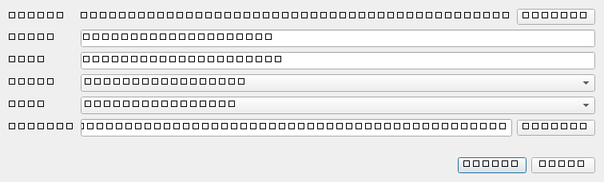

# igz_pdf3d

3D PDF export for [IngeTrazo](https://github.com/ingelibre/ingetrazo): select what you
want to share, click **3D PDF**, and send a one-page PDF that opens as an interactive
3D model in Adobe Acrobat Reader and Bluebeam Revu, with a model tree by layer and
object, materials and textures, named views and a snapshot for viewers without 3D.

The extension itself, its user guide and licence are in [`igz_pdf3d/`](igz_pdf3d/README.md).
Install it from IngeTrazo's **Extensions ▸ Manage extensions…** or drop the folder into
your per-user plugins directory.

- Pure Python, no dependencies; the U3D encoder is a port of the U3D reference library
  (Apache-2.0, see [THIRD-PARTY.md](igz_pdf3d/THIRD-PARTY.md)).
- GPL-3.0-or-later. Requires IngeTrazo 0.5.8 or later.
- Development: `python -m venv .venv`, install `pytest pypdf PySide6`, run
  `.venv/Scripts/python -m pytest -q` (105 tests). `devtools/package.py` builds the catalog ZIP.

